<p align="center">
  <h1 align="center">Limekit</h1>
  <p align="center">Desktop apps in Lua. One codebase for Windows, macOS and Linux.</p>
</p>

```lua
local ui = require("limekit.ui")

local window = ui.Window { title = "Hello", size = { 320, 120 } }
local layout = ui.VLayout()
local button = ui.Button("Click me")

button:setOnClick(function(self)
    self:setText("Clicked!")
end)

layout:addChild(button)
window:setLayout(layout)
window:show()
```

That is a complete Limekit program. No HTML, no CSS, no build step, no C compiler.

---

## 👤 Looking to *build* an app? You don't need this repository.

This repository is the **framework** — the engine your Lua runs on. You never
install it by hand.

Everything you need to write, run and ship a Limekit app comes in one download:

### ➡️ [**Get Limer**](https://github.com/mitosisX/Limer-Limekit/releases) — create and run Limekit apps

Limer is the app you actually use. Download it, unzip it, run it. Limekit is
already inside it, so there is **nothing else to install** — no Python, no
packages, no toolchain.

Limer gives you:

- **New Project**, **Run** and **Build**, from a toolbar
- A **visual Designer** — drag real widgets into real layouts, generate Lua
- A live **Inspector** — pick a widget in your *running* app, read and edit its
  properties, run Lua inside it
- **Ctrl+K** search across the whole Limekit API
- Lua Language Server stubs, so your own editor knows every class and method

The rest of this page is for people who want to work on the framework itself.

---

## 🎨 About

Limekit is a Lua GUI framework. Qt supplies the widgets and the rendering,
`lupa` bridges Python and Lua, and you write pure Lua — the Python underneath is
an implementation detail you never touch.

**Why Lua?** Because a lot of people already write it — for Neovim, for games,
for Roblox, for embedded scripting — and have had no good way to put a real
native window in front of their code.

## 🌟 Features

- **Pure Lua API** — namespaced modules (`ui`, `sys`, `fs`, `db`, `chart`), not a
  pile of globals
- **~90 classes** — widgets, five layout managers, dialogs, charts, tables,
  trees, docks, system tray, timers, threads, SQLite, filesystem
- **Theming built in** — Material, light and dark, switchable at runtime
- **Native widgets** — real Qt, not a web view
- **Editor support** — LSP stubs generated from the framework itself, so
  completion and signatures are never out of date
- **Errors that point at your code** — a failing handler is reported as
  `Button.onClick: main.lua:42: message`, and your app stays up

## 🛠️ How it works

Three layers:

1. **Qt / PySide6** — native widgets and rendering
2. **Declarative widget specs** — each widget declares its properties and
   events once, in Python
3. **The lupa bridge** — the declared surface is generated into the Lua runtime

That one declaration is the only source of truth. From it, Limekit generates the
Lua API, the LSP stubs, the frozen-build manifest and Limer's API index — so
they cannot drift apart:

```python
class Button(LimeWidget, QPushButton):
    __lime__ = "ui.Button"
    text    = Prop(str, qt=("text", "setText"), coerce=str)
    flat    = Prop(bool, qt=("isFlat", "setFlat"))
    onClick = Event("clicked", passes_self=True)
```

...becomes `getText` / `setText`, `getFlat` / `isFlat` / `setFlat`, and a
guarded `setOnClick`, in Lua.

## 🚀 Examples

Over forty example apps — calculator, notepad, kanban, spreadsheet, minesweeper,
pixel editor, CSV explorer, SQLite browser, file explorer, charts, a widget
gallery:

**[limekit-demos](https://github.com/mitosisX/limekit-demos)** — see
`2.0-examples/`

Every one of them boots in Limekit's own test suite, so a framework regression
breaks them here rather than in your hands.

## 🖼️ Showcase

<p align="center">
  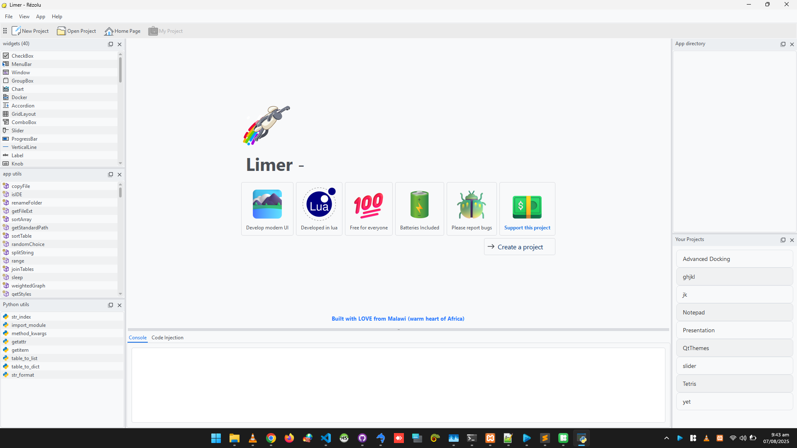
  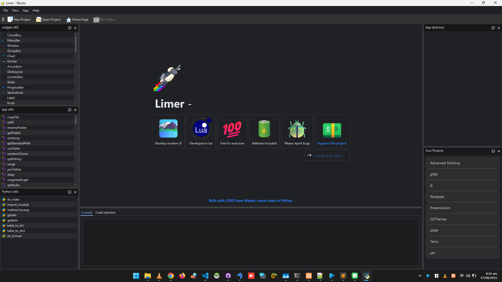
  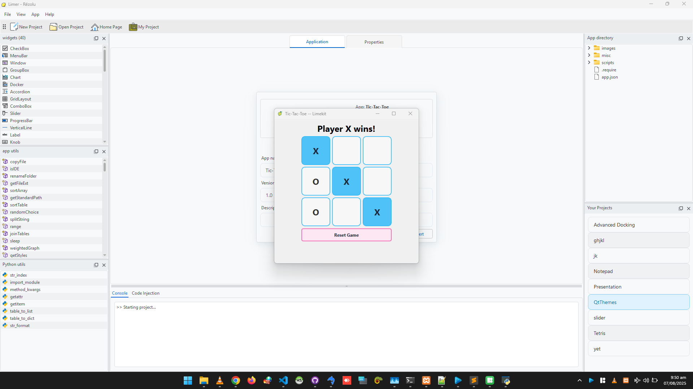
  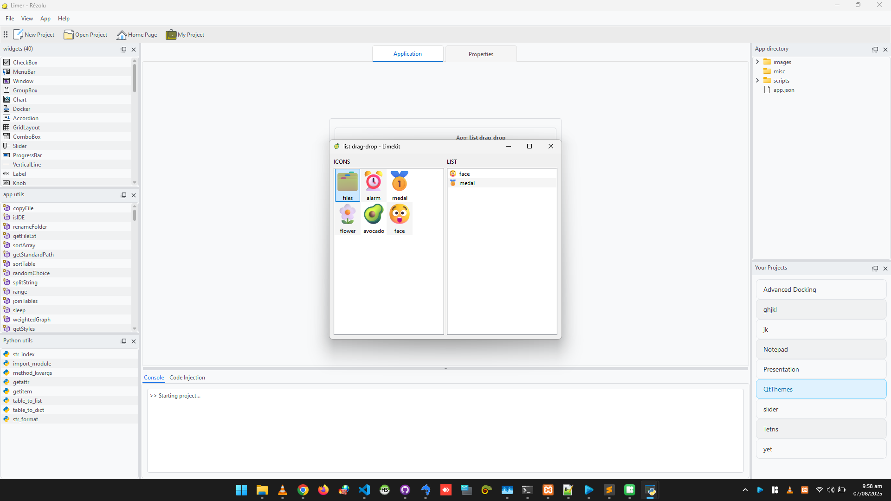
</p>

<details>
<summary>More screenshots</summary>

<p align="center">
  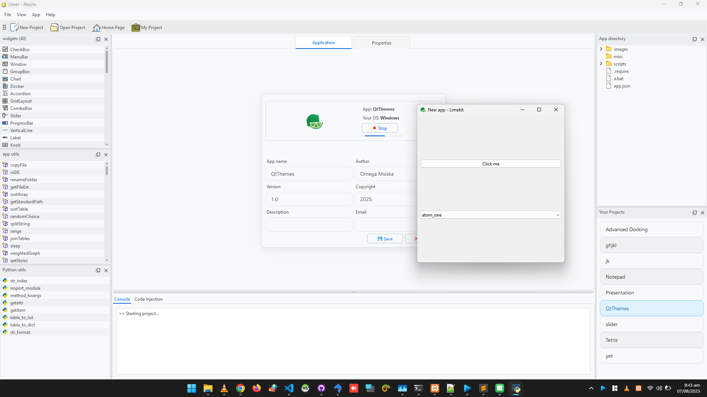
  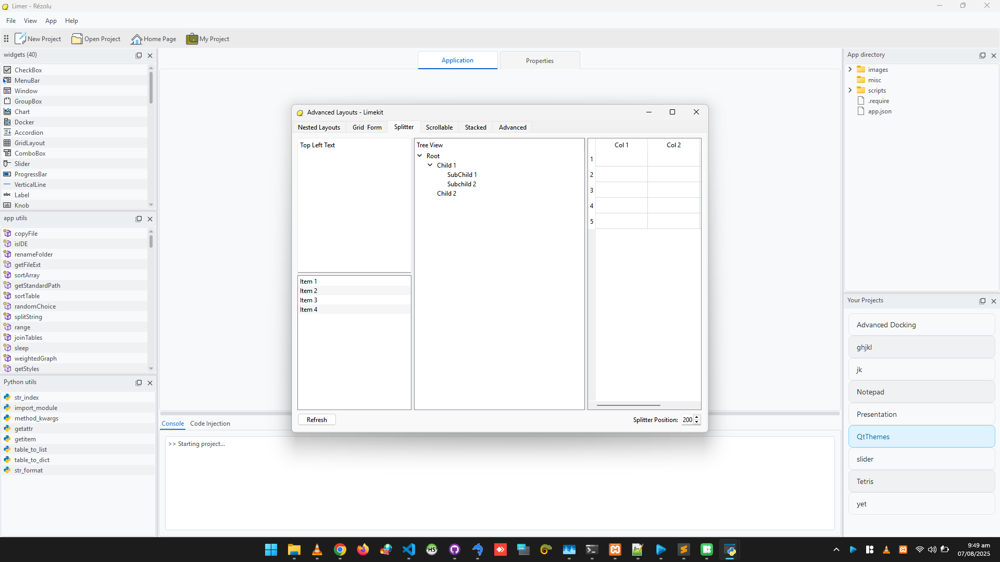
  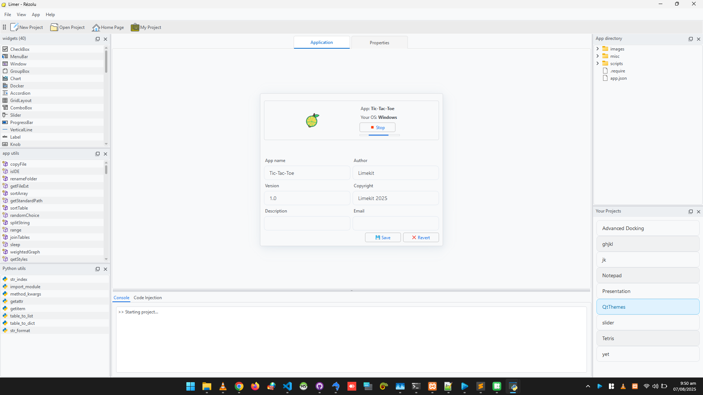
  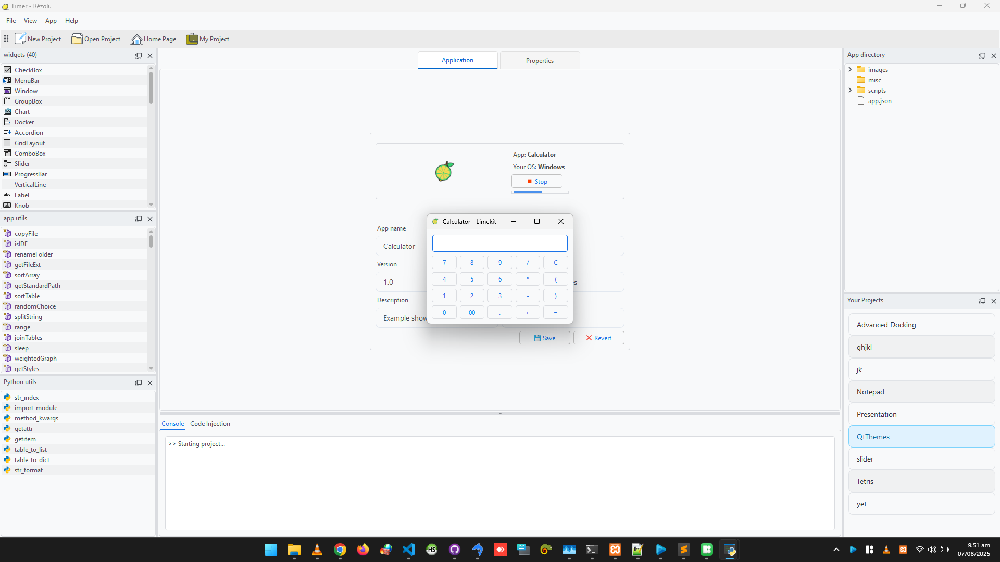
  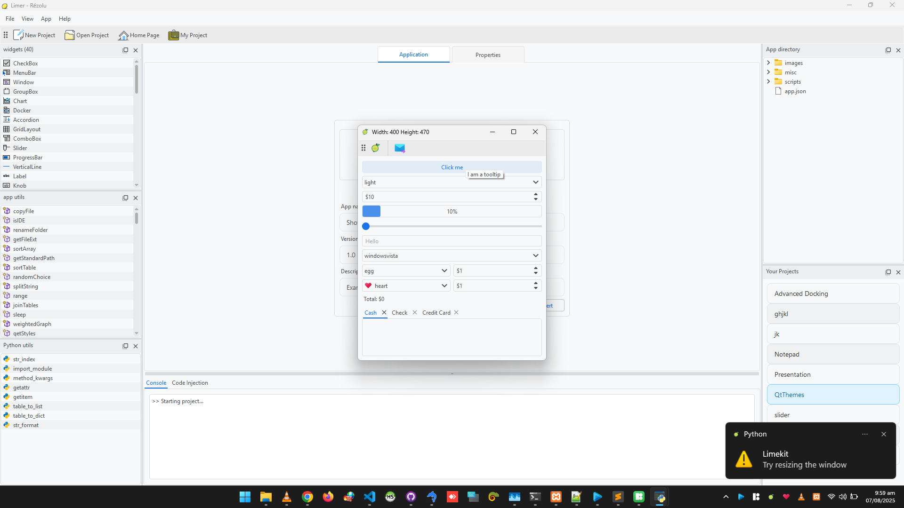
  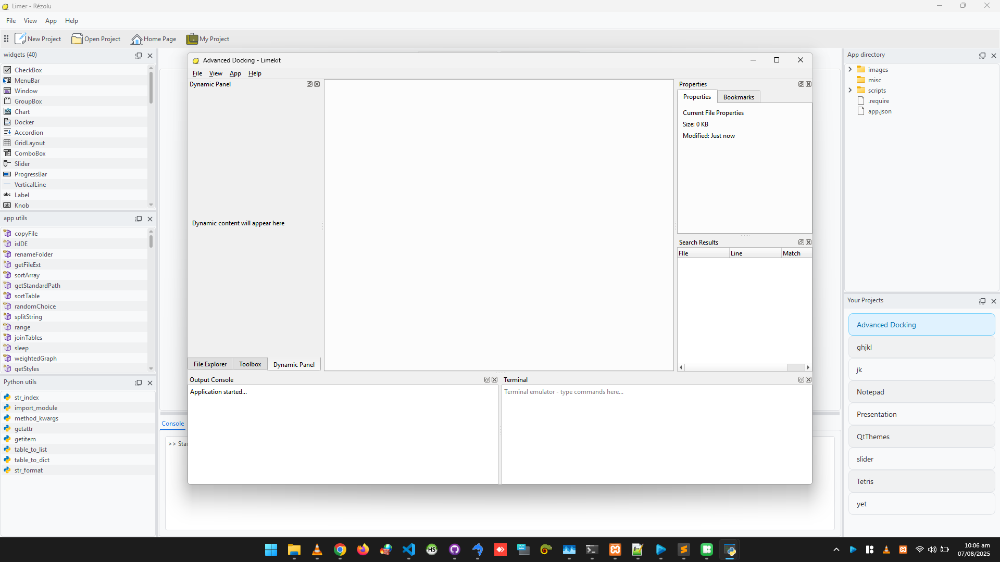
  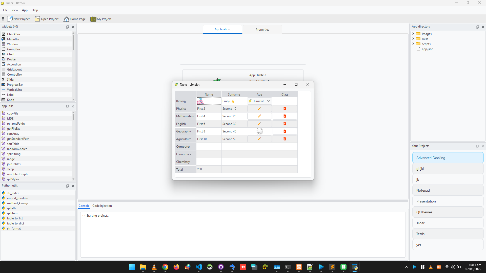
  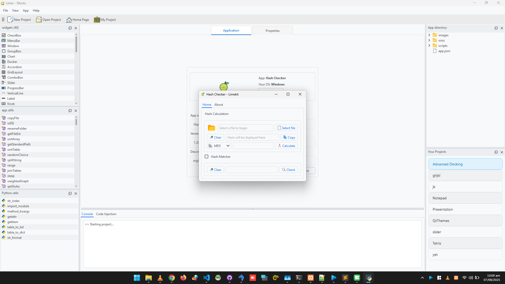
</p>

</details>

## 📚 Documentation

**[limekit.readthedocs.io](https://limekit.readthedocs.io/)**

## ⚠️ Project status

**2.0 is in alpha.** The 2.0 engine is a rewrite: a declarative kernel,
generated bindings, an explicit application lifecycle and a test suite that did
not exist before. The 1.x engine has been retired: a 1.x project is recognised
and refused with a pointer to the migration guide, rather than run. The
[Limer 1.x release](https://github.com/mitosisX/Limer-Limekit/releases) still runs 1.x projects.

Known limits worth knowing before you start something ambitious: there is no
canvas or custom painting yet, no drag and drop for app code, no HTTP client,
tables are item-based rather than model-driven, and background work runs on a
single Lua state. These are the roadmap.

---

## 🧑‍💻 Working on the framework

This is the part that needs Python. Users of Limer never see it.

**Requirements**

- Python 3.10+
- Qt comes in with PySide6 via pip; on Linux you may also need the X11/XCB
  system libraries Qt links against (`libxcb-cursor0` and friends)

**Setup**

```console
git clone https://github.com/mitosisX/Limekit.git
cd Limekit
pip install -e ".[dev,build]"
```

**Run a project straight from a checkout**

```console
python -m limekit path/to/project
```

**Tests**

```console
python -m pytest
```

Headless machines need `QT_QPA_PLATFORM=offscreen`.

### Changing the API

Adding, renaming or removing a class or a `Prop`/`Event` means regenerating the
artifacts built from the registry. **Run them in this order** — the manifest is
written first, and the others read it:

```console
python tools/generate_manifest.py     # frozen-build import list
python tools/generate_lua.py          # the Lua runtime module
python tools/generate_stubs.py        # Lua Language Server stubs
```

`tools/generate_api_index.py` regenerates Limer's Ctrl+K index; it lives here
because Limer ships no Python of its own.

Regeneration is checked to be a no-op, so a stale artifact fails the suite.

### Layout

```
limekit/
├── kernel/      spec · declarative accessors · registry · bridge · app lifecycle
├── widgets/     layouts/  charts/            the 2.0 widget tree
├── services/    theming · database · filesystem · timers · threads · tray
├── toolkit/     text and other helpers
├── build/       PyInstaller packaging
└── runtime/lua/ GENERATED Lua runtime and stubs — never hand-edited
```

The rule: `kernel` depends on nothing else in `limekit`; everything else depends
on `kernel`. That is enforced by import-linter in the test suite, which also
checks the retired 1.x engine stays gone.

## 🤝 Contributing

Contributions are welcome — widgets, bug fixes, documentation, platform testing
(macOS especially). Open an issue before anything large so we can agree on the
shape of it first.

## 📜 License

GPLv3. Copyright © 2025 Omega Msiska.

## 📩 Contact

omegamsiskah@gmail.com
